# SupplyGuard — ce face software-ul, cu capturi de ecran

## Scop

SupplyGuard este un prototip pentru verificarea unor proprietăți de securitate ale unei livrări software: ce componente sunt inventariate, dacă respectă politica locală, dacă fișierele s-au modificat și dacă semnătura unui artefact este validă pentru semnatarul aprobat. Oferă interfață desktop, comenzi CLI și un flux experimental pentru capitolele 4 și 5 ale lucrării.

Utilizatorul selectează operațiunea, alege fișierele sau directoarele și pornește execuția. Aplicația afișează rezultatul într-un tabel și păstrează ieșirea completă în fila „Jurnal”. Codul de ieșire este disponibil pentru integrarea într-un pipeline.

Capturile din acest document provin din aplicația Tkinter rulată efectiv pe Linux. Verificările SBOM, laboratoarele și inventarierea au fost executate pentru realizarea capturilor. Tabelele E1/E2 afișează rezultatele experimentelor reale salvate anterior, fără a rerula toate experimentele la simpla deschidere a ferestrei. Imaginile surprind zona interioară a ferestrelor aplicației.

## Funcțiile, intrările și rezultatele

| Funcție din interfață | Ce primește | Ce execută efectiv | Ce produce |
|---|---|---|---|
| Verificare SBOM | SBOM CycloneDX JSON și politică JSON | Citește componentele, inclusiv cele imbricate; verifică nume, versiune, purl conform politicii și regulile de interzicere nume–versiune. | Acceptare sau lista încălcărilor; cod 0 ori 1. |
| Generare SBOM | Director de aplicație și destinație | Apelează Syft: `syft dir:<director> -o cyclonedx-json=<destinație>`. | Un fișier CycloneDX cu inventarul identificat de Syft. |
| Inventar aprobat | Director și destinație separată | Calculează SHA-256 pentru fiecare fișier; salvează calea relativă și hash-ul. Respinge legăturile simbolice. | Un inventar JSON de referință. |
| Comparare integritate | Director actual și inventar aprobat | Recalculează inventarul și compară căile și hash-urile cu referința. | Liste de fișiere adăugate, eliminate și modificate. |
| Semnare artefact | Fișier și destinație bundle | Apelează Cosign `sign-blob`, în modul keyless al fluxului standard; autentificarea poate necesita browser și servicii externe. | Bundle Sigstore pentru fișierul semnat. |
| Verificare semnătură | Fișier, bundle, identitate și issuer OIDC aprobate | Apelează Cosign `verify-blob` cu identitatea și issuer-ul introduse. | Succes sau eroare de verificare. |
| Laborator atacuri | Scenariu SolarWinds sau XZ | Creează fișiere text temporare, salvează referința, introduce o intervenție controlată și compară inventarele. | `detected` și diferențele observate. |
| Experimente capitolele 4 și 5 | Sursele oficiale Express/Flask, versiunile Syft pregătite, npm și Cosign | Rulează configurațiile A–I și scenariile criptografice T0–T6, completează hash-uri și măsoară durate. | SBOM-uri brute, referințe, loguri, JSON cu măsurători, CSV-uri și raport Markdown. |
| Tabele E1/E2 | Măsurătorile existente în `build/experiments/measurements.json` | Încarcă rezultatele salvate și deschide patru file tabelare. | Vizualizare Express, Flask, hash-uri și Cosign; fără scanare nouă. |
| Exportă rezultatul | Ultimul tabel sau jurnalul ferestrei principale | Scrie rândurile în CSV ori jurnalul în TXT, în funcție de extensie. | Fișier local ales de utilizator. CSV-urile E1/E2 sunt generate separat de fluxul experimental. |

## Capturi și explicații

### Figura 1 — Interfața principală

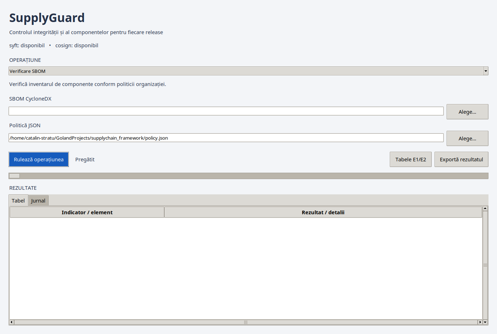

Interfața conține selectorul operațiunii, câmpurile de intrare, butonul de rulare, starea execuției, tabelul și jurnalul. Indicatorii Syft/Cosign arată dacă executabilele sunt găsite. Acești indicatori nu reprezintă rezultatul unei scanări.

### Figura 2 — Acceptarea unui SBOM conform politicii

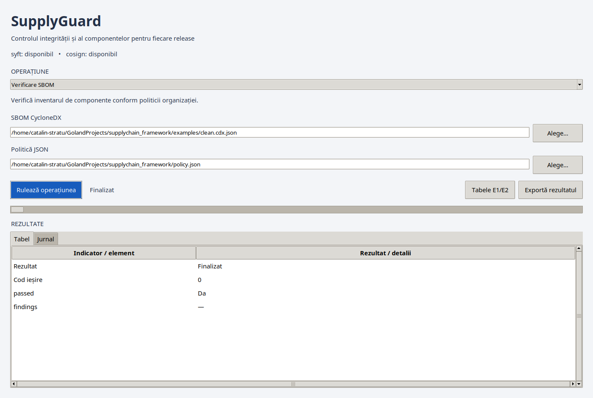

Fișierul `examples/clean.cdx.json` conține componenta demonstrativă `demo@1.0.0`. Politica inclusă nu o interzice, iar câmpurile cerute sunt prezente. Rezultatul este `passed = Da`, fără constatări și cu cod de ieșire 0. Acceptarea arată conformitatea cu regulile locale verificate; nu certifică absența vulnerabilităților sau a codului malițios.

### Figura 3 — Respingerea unei componente interzise

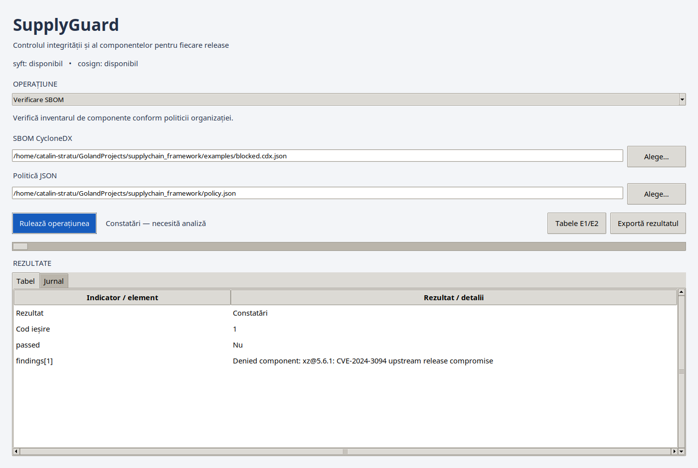

Fișierul `examples/blocked.cdx.json` conține `xz@5.6.1`. Regula din `policy.json` interzice această combinație și aplicația raportează constatarea, `passed = Nu` și codul 1. Programul aplică regula configurată; nu analizează codul pachetului pentru a găsi mecanismul unui backdoor.

### Figura 4 — Demonstrația modificării unui fișier

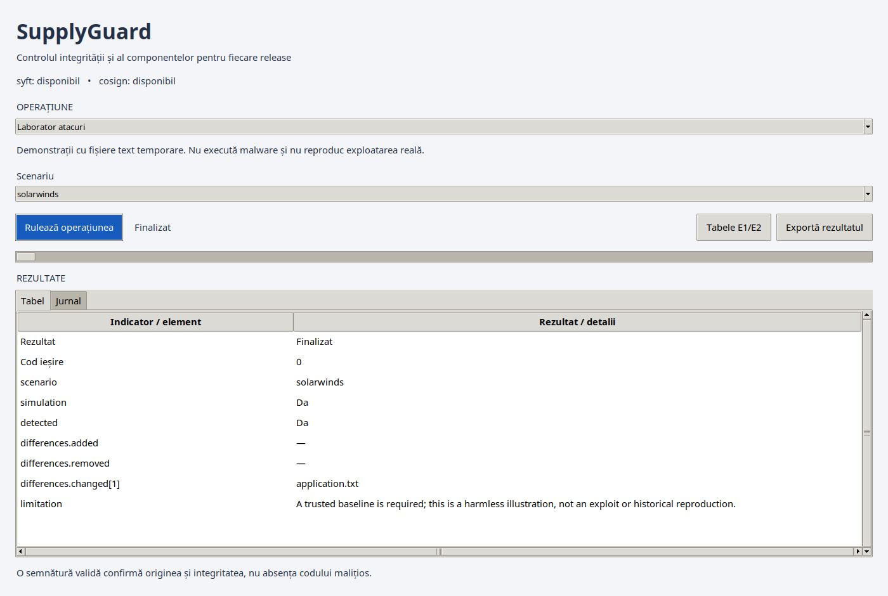

Scenariul etichetat „solarwinds” creează `application.txt`, salvează inventarul, apoi adaugă un marker text. Diferența apare la `differences.changed`, iar `detected = Da`. Este o ilustrare a modificării după stabilirea referinței; nu este o reproducere a malware-ului SolarWinds.

### Figura 5 — Demonstrația adăugării unui fișier

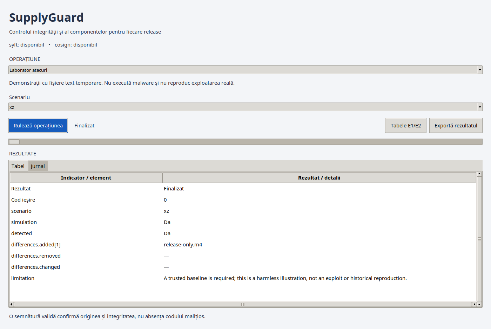

Scenariul „xz” adaugă `release-only.m4` după inventariere. Fișierul este raportat la `differences.added`. Conținutul este text inofensiv; scenariul nu compilează și nu execută cod XZ compromis.

În ambele laboratoare, codul 0 indică executarea cu succes a demonstrației. Detectarea este exprimată separat prin `detected`; nu trebuie confundată cu un rezultat de integritate fără diferențe.

### Figura 6 — Experimentul Express, configurațiile A–F

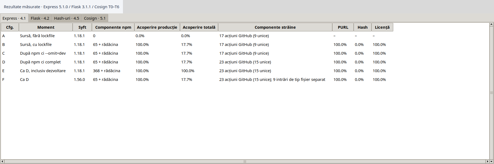

Tabelul compară scanarea fără lockfile, cu lockfile, după instalarea dependențelor de producție, după instalarea completă, cu dezvoltarea activată și cu altă versiune Syft.

| Rezultat măsurat | Semnificație |
|---|---|
| A: 0 componente npm | Scanarea acestei surse fără lockfile nu a inventariat dependențele npm. Acțiunile GitHub rămân prezente. |
| B–D și F: 65 + rădăcina | Inventarul implicit acoperă toate cele 65 de dependențe de producție, adică 17,7% din totalul de 368. |
| E: 368 + rădăcina | Activarea dependențelor de dezvoltare produce acoperire totală de 100%. |
| 17 sau 23 acțiuni GitHub | Scanarea directorului inventariază și referințe din workflow-uri. |
| F: 9 intrări de tip fișier | Sunt metadate suplimentare, raportate separat de pachete. |
| 0% cu hash înainte de completare | Hash-urile componentelor lipsesc în ieșirea inițială măsurată. |

Acoperirea se calculează prin potrivirea perechilor unice nume–versiune cu lockfile-ul de referință. Rădăcina proiectului este afișată separat și nu intră în numitorul procentelor pentru dependențe.

### Figura 7 — Experimentul Flask, configurațiile G–I

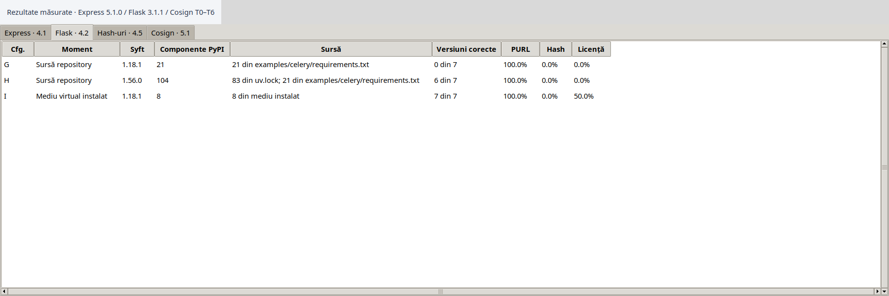

Syft 1.18.1 identifică în sursă 21 de componente provenite din exemplul Celery. Syft 1.56.0 adaugă cele 83 de pachete din `uv.lock`, rezultând 104 intrări PyPI. Scanarea mediului virtual identifică șapte pachete de rulare și pip, cu 7/7 versiuni de rulare corecte.

Procentul de componente cu licență în mediul instalat este 50% în această rulare. Valoarea diferă de cea de 62,5% din documentul Word; mediul și versiunile exacte sunt consemnate în raportul experimental.

### Figura 8 — Completarea hash-urilor componentelor

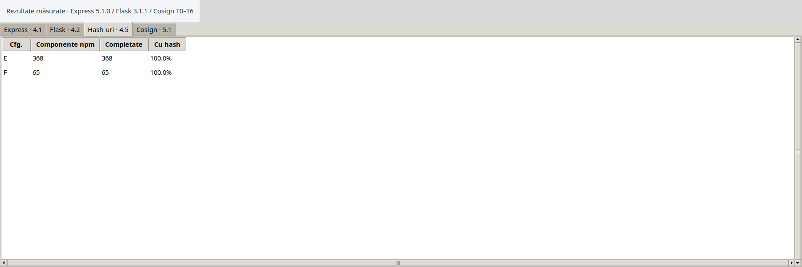

Fluxul citește `integrity` din `package-lock.json`, decodează digestul SRI și îl introduce în componenta CycloneDX corespunzătoare. Au fost completate 368/368 de dependențe în E și 65/65 în F. SHA-512 pentru arhiva `accepts@2.0.0` a fost verificat independent prin descărcare și calcul local.

Această funcție adaugă hash-ul arhivei pachetului. Funcția „Inventar aprobat” calculează hash-uri ale fișierelor locale; cele două tipuri de hash au obiecte diferite.

### Figura 9 — Verificări criptografice reale, T0–T6

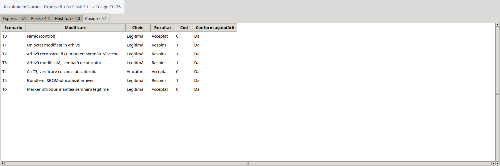

Experimentul folosește două perechi de chei Cosign: legitimă și de atacator. Semnările sunt locale, fără OIDC și fără publicare în jurnalul de transparență. Acest mod experimental este separat de fluxul keyless din operațiunile standard ale interfeței.

| Scenariu | Verificare | Ce demonstrează |
|---|---|---|
| T0 | Acceptat | Artefactul original corespunde semnăturii legitime. |
| T1 | Respins | Modificarea unui octet invalidează verificarea. |
| T2 | Respins | O arhivă reconstruită nu poate folosi semnătura veche. |
| T3 | Respins | Semnătura atacatorului nu este validă pentru cheia legitimă aprobată. |
| T4 | Acceptat | Dacă verificatorul este configurat să aibă încredere în cheia atacatorului, acceptă artefactul acestuia. |
| T5 | Respins | Bundle-ul altui artefact nu validează arhiva. |
| T6 | Acceptat | Modificarea introdusă înainte de semnarea legitimă rămâne acoperită de semnătura validă. |

T6 arată de ce verificarea semnăturii trebuie completată cu verificări ale procesului de build. Semnătura confirmă integritatea față de momentul semnării și semnatarul verificat, nu siguranța conținutului.

### Figura 10 — Crearea inventarului SHA-256

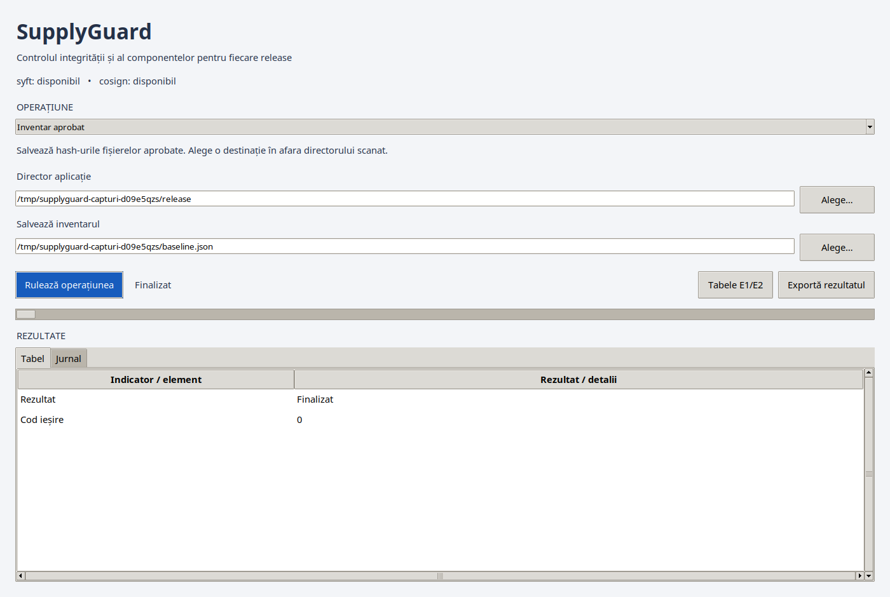

Au fost inventariate două fișiere text dintr-un director temporar. Aplicația a salvat un JSON cu căile relative și hash-urile SHA-256 într-o destinație din afara directorului scanat. Codul 0 confirmă finalizarea operațiunii; în tabel nu sunt afișate automat toate hash-urile din fișierul salvat.

### Figura 11 — Detectarea diferențelor de integritate

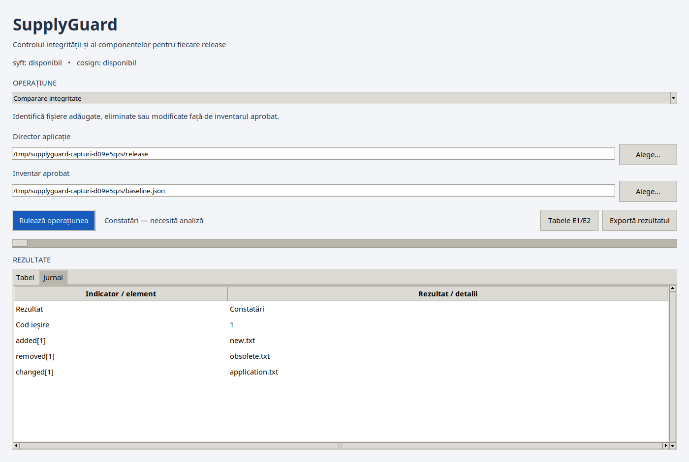

După salvarea inventarului, `application.txt` a fost modificat, `obsolete.txt` a fost șters și `new.txt` a fost adăugat. Comparația a raportat cele trei categorii și a returnat codul 1. Inventarul de referință trebuie păstrat protejat; dacă atacatorul poate înlocui și referința, comparația nu mai oferă aceeași încredere.

## Cum este construit software-ul

| Fișier | Responsabilitate |
|---|---|
| `supplyguard/gui.py` | Interfața Tkinter, validarea câmpurilor, lansarea proceselor în fundal, tabelul și exportul rezultatelor. |
| `supplyguard/cli.py` | Comenzile, inventarierea SHA-256, comparația, politica SBOM și apelurile standard Syft/Cosign. |
| `supplyguard/experiments.py` | Descărcarea și pregătirea experimentelor, măsurătorile A–I și T0–T6, completarea hash-urilor și generarea rapoartelor. |
| `policy.json` | Regulile locale pentru componente. |
| `build/experiments/` | Artefactele locale, SBOM-urile brute, lockfile-ul de referință, logurile, măsurătorile și cheile experimentale. |
| `docs/rezultate-experimente/` | CSV-urile rezultate, cu antete. |

Interfața construiește o listă de argumente și lansează CLI-ul fără shell. Ieșirea procesului este transferată printr-o coadă către interfață. Operațiunea rulează în fundal, iar tabelul este actualizat la final. Acest mecanism păstrează interfața disponibilă în timpul scanărilor.

## Limitele exacte ale prototipului

SupplyGuard implementează verificări locale și un flux experimental reproductibil. Nu implementează un scanner CVE cu bază actualizată, analiza codului malițios, validarea completă a schemei CycloneDX, verificarea provenienței SLSA, build reproductibil automat sau politici de admitere Kubernetes. Recomandările despre aceste mecanisme din lucrare nu constituie funcții implementate.

CLI-ul oferă coduri de ieșire pentru automatizare, dar blocarea unui release sau deployment necesită configurarea pipeline-ului care îl apelează. Interfața afișează constatări; nu oprește de la sine alte aplicații sau procese de livrare.

Capturile documentează funcțiile efectiv afișate. Nu includ o autentificare OIDC reală în browser sau o atestare OCI; tabelul Cosign documentează experimentul local cu cheie.

## Repetare

Interfața standard necesită Python cu Tkinter, iar operațiunile externe necesită Syft/Cosign. Fluxul experimental necesită suplimentar Python 3.11+ și npm.

```bash
# Interfața desktop, după instalarea Tkinter
.venv/bin/python -m supplyguard.gui

# Pregătire și execuție completă E1/E2, cu acces la rețea
python3 -m supplyguard experiment --prepare

# Regenerarea raportului din măsurătorile existente
python3 scripts/reproduce_chapters.py --report-only
```

Pentru această sesiune de captură, Tkinter și biblioteca BLT au fost extrase în `/tmp`, deoarece nu erau instalate în sistem. Capturile nu implică instalarea lor permanentă. Într-un mediu obișnuit Ubuntu/Debian, Tkinter se instalează prin pachetul `python3-tk`.

Raportul detaliat cu valori și mediu: [experimente-capitole-4-5.md](experimente-capitole-4-5.md). Analiza cerințelor: [analiza-capitole-4-5.md](analiza-capitole-4-5.md).
